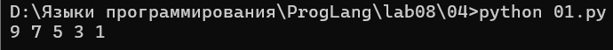

# Языки программирования
## Лабораторная работа 8

### Задание 1 **(2)**
*Рассмотрим программу на языке* **Python**.
```
x = [int(t) for t in input().split()]
for i in range(len(x)):
   if x[i] < i or x[i] > 2*i:
      break
print(i)
```
*Перепишите эту программу так, чтобы в ней использовался цикл* **while**, *в ней не использовалась
инструкция* **break**, *а используемый алгоритм не изменился. Полученная программа должна иметь следующий 
вид.*
```
x = [int(t) for t in input().split()]
i = 0
while ...:
   i += 1
print(i)
```
*Допишите правильное логическое выражение вместо многоточия. Выражение не должно содержать оператор* **not**.  
Ответ:  
```
x = [int(t) for t in input().split()]
i = 0
while i < len(x) and x[i] >= i and x[i] <= 2*i:
   i += 1
print(i)
```

### Задание 2 **(2)**
*Рассмотрим программу на языке* **Python**.
```
x = [int(t) for t in input().split()]
for i in range(len(x)):
   if i <= x[i] < 2*i or 3*i <= x[i] < 4*i:
      break
print(i)
```
*Перепишите эту программу так, чтобы в ней использовался цикл* **while**, *в ней не использовалась
инструкция* **break**, *а используемый алгоритм не изменился. Полученная программа должна иметь следующий 
вид.*  

Ответ:  
```
x = [int(t) for t in input().split()]
i = 0
while ...:
   i += 1
print(i)
```
*Допишите правильное логическое выражение вместо многоточия. Выражение не должно содержать оператор* **not**.  

Ответ:  
```
x = [int(t) for t in input().split()]
i = 0
while i < len(x) and (x[i] < i or x[i] >= 2*i) and (x[i] < 3*i or x[i] >= 4*i):
   i += 1
print(i)
```

### Задание 3 **(2)**

*Напишите пример программы на* **Java** *с двумя вложенными циклами и инструкцией* **break** *для выхода
из двух вложенных циклов. В качестве такой программы можно взять поиск первого нуля в двумерном массиве.*

Ответ:  
```
public class Main{
    public static void main(String[] args){
        int[][] m = {{1, 2, 3}, {4, 0, 6}, {7, 8, 9}};
        outer:
        for (int i = 0; i < m.length; i++) {
            for (int j = 0; j < m[i].length; j++) {
                if (m[i][j] == 0) {
                   System.out.println("Найден на " + i + " и " + j);
                   break outer;  
                }
            }
        }
    }
}
```

### Задание 4 **(2)**

*Рассмотрим программу на языке* **Python**.
```
a = list(range(10))
b = [a.pop() - x for x in a]
print(*b)
```
*Объясните, почему список* **b** *получился именно таким.*  
Ответ:  
a = [0, 1, 2, 3, 4, 5, 6, 7, 8, 9]  
При каждом шаге a.pop() удаляет последний элемент и возвращает его, а x берётся из текущего списка. После 
5 шагов итератор исчерпан. Вывод:  

Список b получается таким потому что pop() меняет сам список во время итерации

### Задание 5 **(2)**

*Напишите программу на С++, которая прочитает натуральное число* **n**, *создаст вектор
из* **n** *элементов, прочитает значения элементов, добавит последний элемент вектора к каждому элементу 
(в том числе и к последнему), найдет и выведет количество положительных и отрицательных элементов вектора
после изменения. Из циклов в программе можно использовать только циклы по коллекции.*

### Задание 6 **(3)**

*Представим, что в некотором будущем стандарте* **С++** *появится конструкция*
```
forc(i, from, to)
```
*которая будет раскрываться в следующий код.*
```
{
   int __i = from, __n=to;
   for(const int &i= __i; i < __n; __i++) {
      ...
   }
}
```
*Чем эта конструкция отличается от стандартного цикла* **for**? *Укажите два основных различия.
Напишите программы для демонстрации этих различий.*

*Написанные программы сохраните в папку с номером задания.*


### Задание 7 **(2)**

*Напишите программу на языке* **Python** *для проверки того, что все числа во введенной 
последовательности неотрицательные. Если в цикле будет найдено отрицательное число, цикл должен
прерваться и вывести найденное число. Если отрицательных чисел нет, то вывести некоторое сообщение об этом.*

*Программа должна использовать конструкцию* **for break else**.  
Ответ на Python:  
```
x = [int(t) for t in input().split()]
for i in x:
     if i < 0:
        print("Found negative: ", i)
        break
else:
     print("All numbers are non-negative")
```

*Запишите аналогичную программу на С++. Какие изменения в алгоритме решения в ней появились?. Почему?*  
Ответ на C++:  
```
int main(){
   int n;
   std::cin >> n;
std::vector<int> x(n);
for (auto& elem : x) std::cin >> elem;
bool found = false;
for (auto num : x) {
if(num < 0) {
std::cout << "Найдено отрицательное число: " << num << std::endl;
found = true;
break;
}
}
if(!found) {
std::cout << "Все числа неотрицательные: " << std::endl;
}
return 0;
}
```

В C++ нет конструкции for...else, поэтому пришлось добавить переменную флаг found, чтобы запомнить было ли 
найдено отрицательное число.  
*Написанные программы сохраните в папку с номером задания.*

### Задание 8 **(2)**

*Рассмотрим следующую программу.* 
```
if x>=5 and y>=-5:
   print(0):
elif x<0 or y<0:
   print(1):
else:
   print(2):
```
*Опишите множества значений при которых программа выводит 0, 1 и 2. Например,*

A={ (x,y)| x ? [5;?), y ? [-5;?)}  

Ответ:  
Вывод 0: x >= 5 and y >= -5
A = {(x, y) | x принадлежит [5; +inf), y принадлежит [-5; +inf)}  

Вывод 1: (x < 5 or y < -5) and (x < 0 or y < 0)  
A = {(x, y) | x < 0, y принадлежит R} U {(x, y) | x прнадлежит [0; 5), y принадлежит (-inf; -5)}  

Вывод 2: (x < 5 or y < -5) and x >= 0 and y >= 0  
A = {(x, y) | x принадлежит [0; 5), y принадлежит [0; +inf)}

###  Задание 9 **(3)**
*Напишите программу на языке Python для решения следующей задачи.*

*Задана пронумерованная последовательность логических значений* **t(0),t(1),..,t(n)**, **t(i) ? {False,True}**

*Последовательность обладает следующим свойством: существует некоторое число k такое, что 
все значения* **t(0),t(1),...,t(k-1)** *равны* **False**, *а все значения* **t(k), ... , t(n)** *равны* **True**,
*то есть слева от* **k** *находятся значения* **False**, *а справа* - **True**. *Последовательность задается
функцией* **t(i)**, *которая возвращает логическое значение. Например, для тестирования эту функцию можно
задать следующим образом.*
```
def t(i):
   return i>=1000
```

*Требуется написать программу, которая найдет число* **k**. *Программа должна реализовывать алгоритм 
бинарного поиска. Диапазон поиска задается переменными* **left** и **right**. *На каждом шаге вычисляется
центр диапазона, значение в нем проверяется, после чего диапазон сокращается в два раза.*

*Алгоритм должен быть записан через цикл* **while** *и реализовывать инвариант цикла*

t(left)=False ? t(right)=True

```
left = -1
right = 10**18
while ...:
   mid = ...
   if t(mid):
      ...
   else:
      ...
print(...)
```

## Дополнительные задания

### Задание 1 **(5)**

*Напишите программу на языке С++, которая будет находить сумму элементов в матрице и использовать для суммирования только один цикл* **for**. *(То есть вложенные циклы использовать нельзя).*

### Задание 2 **(15)**
*Напишите программы на языке С++ с использованием разных видов циклов, ветвлений в полной и краткой форме, переведите их в ассемблерный код без оптимизации и опишите, как реализуются эти конструкции в элементарных командах.
правил.*